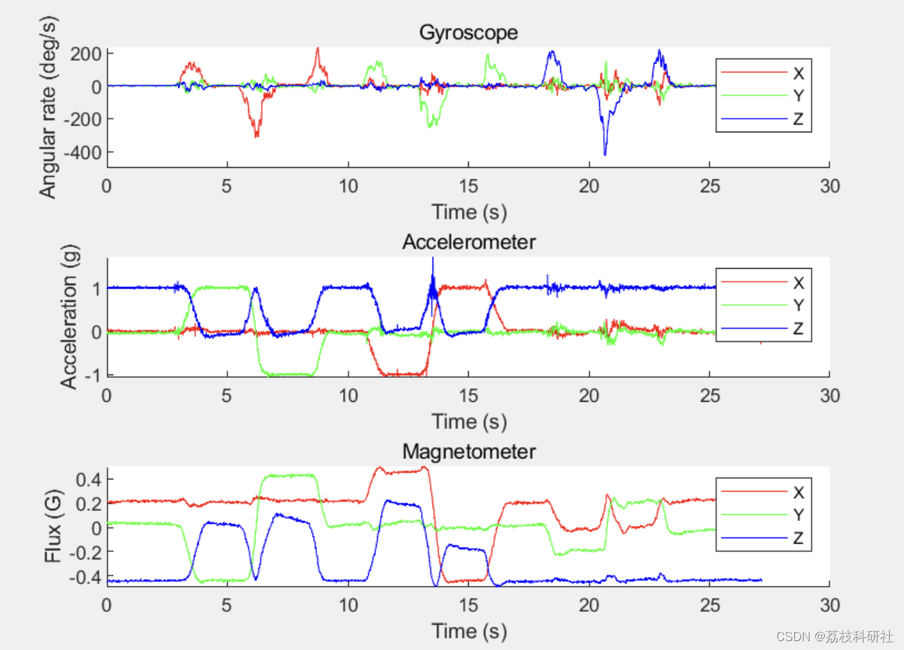
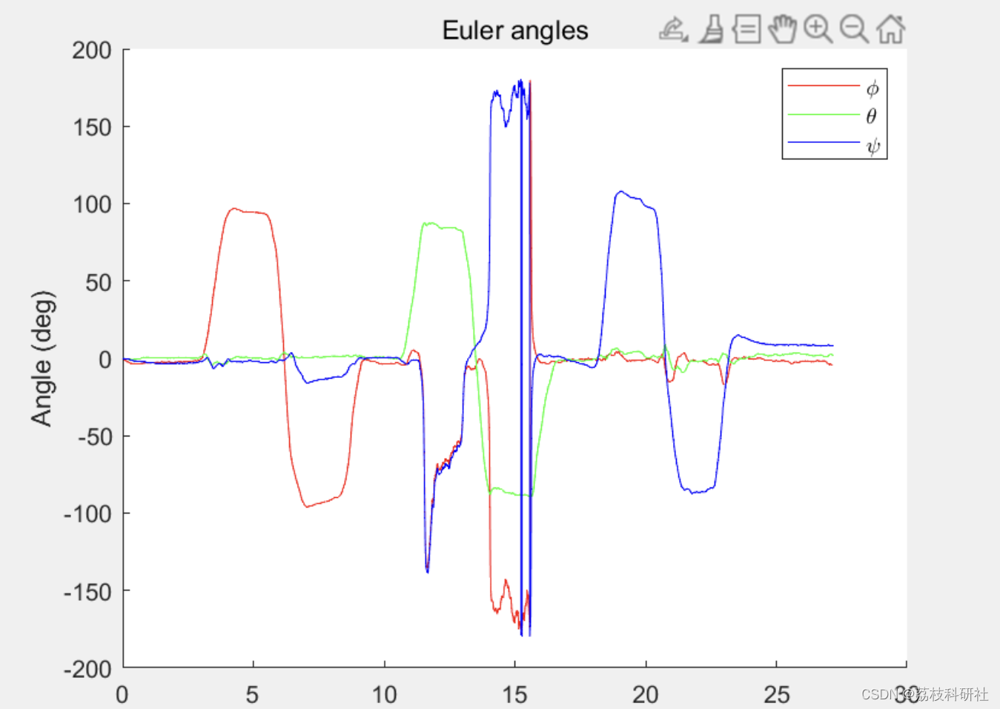

# A Multi-source Information Fusion Method and Its Application (Matlab Code Implementation)

🏆 Bloggers' Advantage: 🌞🌞🌞 The content of the blog strives to be rigorous in thought and clear in logic, aiming to facilitate readers.
⛳️ Mantra: "The journey of a hundred miles is half completed by the ninety-ninth mile."
📋📋📋 This article's outline is as follows: 🎁🎁🎁 Outline💥1 Overview📚2 Run Results🎉3 References🌈4 MATLAB Code Implementation
​Edit💥1 Overview Multi-source Information Fusion (abbreviated as information fusion) refers to the technique of combining and integrating multiple sources of information or data to form a unified result. It originated in military applications of multi-sensory integration, often referred to as multi-sensor data fusion (or data fusion), which is a functional simulation of how humans or animals use various senses to acquire information and then integrate this information through the brain to understand the objective world. With the advancement of research, "sensors" in the field of information fusion are broadly defined as any source of information, including electronic sensors, but also databases, network systems, etc. By leveraging machine systems for information fusion, not only can system performance be effectively improved, but it can also expand human cognition capabilities, assist in decision-making, and enhance problem-solving efficiency. Therefore, information fusion technology has broad application prospects both in military and civilian fields. In recent years, with the development of information technology, a new surge of interest in research on information fusion technology has emerged both domestically and internationally.
Information fusion is essentially a simulation of the brain's ability to analyze information comprehensively. Its goal is to gain an understanding or knowledge of things (including entities, relationships, and events) to facilitate effective decision-making. Among these, entities include both individual targets and the fusion subject (system or person), while relationships reflect the associations and contexts among entities, and events generally relate to time, reflecting the dynamic behavior, state, or changes in relationships (including the appearance and disappearance of entities in certain contexts). The core tasks of information fusion include: (1) Combining multi-source information to enhance its completeness; (2) Excluding redundancy and noise to reduce uncertainty, thereby improving the accuracy and reliability of information; (3) Resolving contradictions and preserving truth, enhancing the consistency and credibility of information. These tasks are complementary, leading to many other benefits such as expanding the system's temporal and spatial coverage, improving the utilization rate of information and resources, supporting more effective inference and decision-making, and enhancing the overall performance of the system.
📚2 Run Results​Edit
​Edit
Part of the code:
load('ExampleData.mat');
figure('Name', 'Sensor Data');
axis(1) = subplot(3,1,1);
hold on;
plot(time, Gyroscope(:,1), 'r');
plot(time, Gyroscope(:,2), 'g');
plot(time, Gyroscope(:,3), 'b');
legend('X', 'Y', 'Z');
xlabel('Time (s)');
ylabel('Angular rate (deg/s)');
title('Gyroscope');
hold off;
axis(2) = subplot(3,1,2);
hold on;  
plot(time, Accelerometer(:,1), 'r');  
plot(time, Accelerometer(:,2), 'g');  
plot(time, Accelerometer(:,3), 'b');  
legend('X', 'Y', 'Z');  
xlabel('Time (s)');  
ylabel('Acceleration (g)');  
title('Accelerometer');  
hold off;  
axis(3) = subplot(3,1,3);  
hold on;  
plot(time, Magnetometer(:,1), 'r');  
plot(time, Magnetometer(:,2), 'g');  
plot(time, Magnetometer(:,3), 'b');  
legend('X', 'Y', 'Z');  
xlabel('Time (s)');  
ylabel('Flux (G)');  
title('Magnetometer');  
hold off;  
linkaxes(axis, 'x');  
%% Process sensor data through algorithm  
AHRS = MadgwickAHRS('SamplePeriod', 1/256, 'Beta', 0.1);  
% AHRS = MahonyAHRS('SamplePeriod', 1/256, 'Kp', 0.5);  
quaternion = zeros(length(time), 4);  
for t = 1:length(time)  
AHRS.Update(Gyroscope(t,:) * (pi/180), Accelerometer(t,:), Magnetometer(t,:));   % gyroscope units must be radians  
quaternion(t, :) = AHRS.Quaternion;  
end  
%% Plot algorithm output as Euler angles  
% The first and third Euler angles in the sequence (phi and psi) become  
% unreliable when the middle angles of the sequence (theta) approaches �90  
% degrees. This problem commonly referred to as Gimbal Lock.  
% See: http://en.wikipedia.org/wiki/Gimbal_lock  
euler = quatern2euler(quaternConj(quaternion)) * (180/pi);   % use conjugate for sensor frame relative to Earth and convert to degrees.  
figure('Name', 'Euler Angles');  
hold on;  
plot(time, euler(:,1), 'r');  
plot(time, euler(:,2), 'g');  
plot(time, euler(:,3), 'b');  
title('Euler angles');  
xlabel('Time (s)');  
ylabel('Angle (deg)');  
legend('\phi', '\theta', '\psi');  
hold off;  
🎉3 References
🌈4 Matlab code implementation

## Images

<!-- PAYMENT_BLOCK -->

## Get this dataset

- Payment link (Stripe): [Buy now](https://buy.stripe.com/3cs8yP7sY87d0vu9AB)
- Payment QR code: 

<!-- /PAYMENT_BLOCK -->
